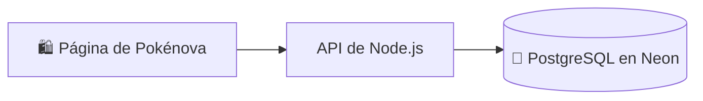

# Conectar Pokénova a Neon 🐘

Neon guarda los productos, precios y existencias en una base de datos PostgreSQL. La página los consulta a través de una API de Node.js: el navegador nunca recibe la contraseña de conexión.



El código está preparado, pero todavía necesitas crear el proyecto y configurar su conexión. Este archivo no confirma una base de datos remota conectada ni una página pública.

## 1. Crear la base de datos

1. Entra en [Neon](https://neon.com/) y crea un proyecto para Pokénova.
2. Puedes comenzar con el plan gratuito para las pruebas. Revisa sus límites vigentes de almacenamiento y uso en tu cuenta antes de publicar o aumentar el catálogo.
3. Abre el **SQL Editor**, selecciona la base de datos del proyecto y ejecuta una sola vez el contenido completo de [schema.sql](schema.sql).
4. Comprueba que existe la tabla `public.products`.

El archivo está pensado para una base nueva. Si ya existe una tabla `products`, revisamos su estructura antes de aplicarlo. No borres datos para resolver un error.

La tabla comienza vacía. No se copian los precios ni el inventario de muestra como productos reales.

## 2. Guardar la conexión en tu computador 🔐

En el panel de Neon, abre **Connect** y copia la cadena de conexión de PostgreSQL. Incluye usuario, contraseña y dirección del proyecto: guárdala de forma privada, sin enviarla al chat ni subirla a GitHub.

En la carpeta del proyecto, copia `.env.example` a `.env.local`. En CMD de Windows puedes hacerlo así:

```bat
copy .env.example .env.local
```

Edita `.env.local` y completa:

```dotenv
DATABASE_URL=TU_CADENA_PRIVADA_DE_NEON
VITE_CATALOG_API_URL=/api/products
```

Conserva los parámetros de conexión que proporciona Neon, incluido `sslmode=require` cuando esté presente. El archivo `.env.local` está excluido de Git.

`DATABASE_URL` la usa exclusivamente el servidor. No le pongas el prefijo `VITE_`: las variables con ese prefijo se incluyen en el código público del navegador. `VITE_CATALOG_API_URL` solo indica la dirección de la API y no lleva credenciales.

## 3. Arrancar la página en tu computador 💻

Usa **Node.js 24** y abre la carpeta que contiene `package.json`. Instala las dependencias:

```bat
npm ci --include=dev
```

Luego mantén abiertas dos terminales dentro de esa misma carpeta:

| Terminal | Comando | Para qué sirve |
| --- | --- | --- |
| 1 | `npm run dev:api` | Inicia la API local en el puerto 3001. |
| 2 | `npm run dev` | Inicia Vite para ver y editar la página. |

Abre en el navegador la dirección que muestra Vite. Vite redirige las consultas a `/api/products` hacia la API local. Si cambias `.env.local`, reinicia ambos procesos con **Ctrl + C** y vuelve a ejecutar los comandos.

Si aparece «vite no se reconoce», ejecuta nuevamente `npm ci --include=dev` dentro de la carpeta del proyecto. No necesitas instalar Vite globalmente ni borrar `package-lock.json`.

## 4. Agregar productos y fotografías 🛍️

Puedes editar las filas desde la vista de tablas de Neon, si está disponible en tu consola, o desde **SQL Editor**. Por ahora no hay un panel de administración propio en la página.

| Campo | Qué guardar |
| --- | --- |
| `id` | Identificador generado automáticamente. Consérvalo al actualizar la ficha. |
| `name` | Nombre del producto. |
| `category` | `cards`, `sealed`, `plush` o `accessories`. |
| `price` | Precio real en CLP, como entero sin puntos: `18990`. |
| `stock` | Unidades disponibles; `0` significa agotado. |
| `image` | Ruta local `/images/foto.jpg`, una URL HTTPS pública o `NULL`. |
| `description` | Estado, idioma, tamaño y otros detalles del producto. |
| `badge` | Etiqueta opcional, como `Nuevo`, o `NULL`. |
| `tone` | `yellow`, `orange`, `purple`, `peach`, `blue` o `mint`. |
| `sort_order` | Orden de aparición: primero los números menores. |
| `is_published` | `true` para mostrar la ficha; `false` para mantenerla como borrador. |

Las fotografías no se guardan como archivos dentro de PostgreSQL. Para una foto local, copia el archivo en `public/images/` con un nombre sencillo, por ejemplo `caja-mazo.jpg`, y guarda `/images/caja-mazo.jpg` en `image`. También puedes usar la URL HTTPS de una imagen alojada en otro servicio. Si modificas archivos de fotos locales, deberás volver a publicar la web.

Para preparar una ficha desde SQL Editor, puedes usar esta plantilla reemplazando los valores por los datos reales. Déjala como borrador mientras revisas su contenido:

```sql
insert into public.products
  (name, category, price, stock, image, description, is_published)
values
  ('NOMBRE REAL', 'accessories', 18990, 1, '/images/tu-foto.jpg',
   'DESCRIPCIÓN REAL', false)
returning id;
```

El precio y las existencias de esa plantilla son ejemplos: cámbialos antes de publicar. Para mostrar la ficha cuando esté lista, usa su identificador:

```sql
update public.products
set is_published = true
where id = 'IDENTIFICADOR_DEL_PRODUCTO';
```

La API solo acepta consultas de lectura de productos publicados. El carrito sigue siendo una lista para consultar por WhatsApp: no realiza pagos, reservas ni descuentos de stock. Actualiza las existencias después de acordar una venta. Las cajas, organizadores y soportes 3D a medida continúan cotizándose por WhatsApp.

Los cambios de precios, textos y stock en Neon se ven al abrir o recargar la tienda; no requieren volver a compilarla.

## 5. Publicar la web más adelante 🌐

Para usar Neon necesitamos alojar también la API. Una publicación estática en GitHub Pages, por sí sola, no ejecuta el servidor de Node.js.

Una opción para pruebas es un **Web Service de Render**, conectado al repositorio de GitHub, que sirva la página y la API desde la misma dirección:

| Configuración de Render | Valor |
| --- | --- |
| Build Command | `npm ci --include=dev && npm run build` |
| Start Command | `npm start` |
| Variable privada | `DATABASE_URL` con la cadena de Neon. |
| Variable pública de compilación | `VITE_CATALOG_API_URL=/api/products` |

Render proporciona el puerto mediante `PORT`; no necesitas asignarlo manualmente. Usa Node.js 24 para mantener la misma versión que en desarrollo.

El archivo [render.yaml](../render.yaml) deja preparada esa configuración con `plan: free`. Si lo usas desde **New → Blueprint** en Render, revisa el servicio y completa la conexión privada cuando la plataforma la solicite. El archivo por sí solo no publica la página.

Antes de elegir el plan gratuito, revisa su disponibilidad y sus límites vigentes. Un servicio gratuito puede suspenderse por inactividad y tardar en responder al volver a abrir la tienda; también debes considerar los límites de Neon. No hace falta contratar un plan de pago para preparar estos archivos.

Esta guía no crea servicios ni activa una publicación. Cuando tengas la base conectada y el catálogo revisado, podremos comprobar el despliegue y usar la dirección pública que realmente entregue el alojamiento.
